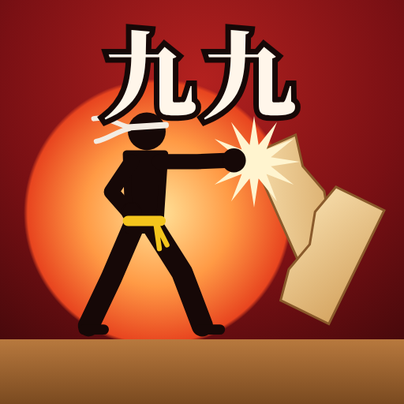

# 九九道場（くく どうじょう）

板を割って帯を上げる！ 九九の **こたえ** と **よみかた**（「しちは ごじゅうろく」など）を、空手の試割りゲームで覚えるブラウザゲームです。
スマホの縦画面向け。インストール不要で、ブラウザで開くだけで遊べます。

## 遊び方

1. 道場の画面で「1のだん」〜「9のだん」の木札をえらぶ
2. 「おぼえる」で九九を聞きながら となえる（「こたえを かくす」で自分テストもできる）
3. 「しあい スタート」で、ランダムに出る9問に時間内に答える
   - 正解すると板が割れる。2.5秒以内なら「かいしん！」でボーナス
   - まちがえると、正しい読み方を見せて読み上げ、あとでもう一度出る
   - ライフは3つ

### 問題の種類（せっていで切りかえ）

| しゅるい | 出かた | こたえかた |
|---|---|---|
| すうじ | 板に「7 × 8」 | 数字をえらぶ |
| よみかた | 板に「しちは ？」 | 「ごじゅうろく」などの読み方をえらぶ |
| きいて こたえる | 「しちは」と読み上げる | 数字をえらぶ（声オンのときだけ） |

「ミックス」では3種類がまざって出ます。

### ★と帯

- ★ … クリア
- ★★ … ノーミスでクリア
- ★★★ … ノーミスで、答えるまでの平均が3秒以内

★を集めると帯が上がります。

しろおび → きいろおび（★3）→ オレンジおび（★6）→ みどりおび（★10）→ あおおび（★14）→ むらさきおび（★18）→ ちゃいろおび（★22）→ くろおび（★26）→ くくマスター（★30）

★は 1〜9のだん（各3つ）と、ボス「かわら18まいわり」（2〜9のだんから18問）の合計30こ。

### にがて とっくん

まちがえた九九や、答えるのに4秒以上かかった九九を自動で記録して、多いものから9問出します。速く正解すると だんだん「にがて」から外れます。

### せってい

- こたえる じかん：10秒 / 7秒 / 5秒 / 3秒（「よみかた」の問題は +1秒）
- もんだいの しゅるい：ミックス / すうじ / よみかた
- よみあげる こえ：オン / オフ
- こうかおん：オン / オフ
- きろくを ぜんぶ けす
